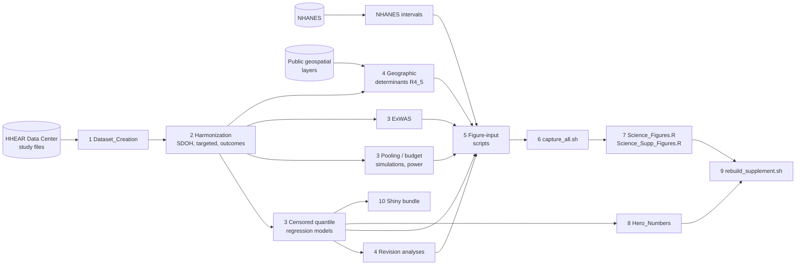

# Population Structure of the Exposome Shapes Epidemiological Inference

Analysis code for the manuscript *Population Structure of the Exposome Shapes
Epidemiological Inference* (Lloyd D. T., Patel C. J., *et al.*; under review at
*Science*). The paper pools targeted chemical biomarker data from 38 cohorts in
the NIH Human Health Exposure Analysis Resource (HHEAR) and shows how much of
the variation in the chemical exposome is explained by where and when a
population was sampled, and what that structure does to pooled
exposure–outcome estimates.

This branch (`submission3`) holds the code for the revised submission. Earlier
versions are in the git history.

- **Interactive explorer:** <https://chiragjp.shinyapps.io/HHEAR_Exposome_Explore/>
  (source in [`HHEAR_Man1_App/`](HHEAR_Man1_App/))
- **Data:** HHEAR Data Center, <https://hheardatacenter.mssm.edu/> (see
  [Data access](#data-access))

---

## Repository layout

```
Coding/
├── HHEAR_Dataset_Creation.Rmd          1  raw HHEAR files -> one RData per study
├── HHEAR_Data_Clean_V2.Rmd             2  demographics / SDOH harmonization
├── HHEAR_Data_Clean_Targeted_V3.Rmd    2  targeted chemical harmonization (LOD, units, dilution)
├── rebuild_harmonized_targeted.sh      2  canonical wrapper for V3 (+ tag_dilution_adjustment.R)
├── HHEAR_Data_Clean_Outcomes.Rmd, HHEAR_*Health_Outcomes*.R   2  health outcomes
├── IMHRD_Reconstruct_Distribution.R    2  external PFAS reference series (fig. S11C)
├── build_targeted_analyte_mapping.py   2  analyte -> exposure-class crosswalk
├── Final_Quantile_Reg_Pipeline/NHANES_Replication/   2-3  NHANES reference intervals
├── Paper1_Submission2/                 3  models, simulations, power   (README inside)
│   ├── Reviewer_Round2/                4  revision analyses, incl. geographic determinants
│   └── Vis_Code/                       5-7 figure inputs and Science-format export
├── Matrix_Stratified/                  3-5 matrix (urine/blood) sensitivity, fig. S20
├── Hero_Numbers.Rmd, Hero_Numbers_Supp.Rmd   8  every number quoted in the text
├── export_supplementary_figs.sh, rebuild_supplement.sh   9
├── Supplementary_Build/                9  builds the supplementary materials .docx
└── build_hhear_man1_app_bundle.{sh,R}  10 data bundle for the Shiny app
HHEAR_Man1_App/app.R                    the Shiny explorer
Input/, Output/                         empty; created and filled by the pipeline
```

## Pipeline



## Running it

Requirements: R ≥ 4.4 (`Rscript Coding/install_packages.R` installs every
package used), Python ≥ 3.10, Node ≥ 18 with `npm install` in
`Coding/Supplementary_Build/` (for the supplement `.docx`), and poppler
(`pdftoppm`, `pdfunite`). The power simulations are SLURM array jobs; the
between-cohort one needs about two days of CPU time.

Working directories: `.Rmd` files are rendered from their own folder and most
`.R` scripts in `Coding/Paper1_Submission2/` are run from their own folder
(`render_chain.sh` does both). The revision scripts in `Reviewer_Round2/`,
`Matrix_Stratified/`, `capture_plots.R` and `Science_*Figures.R` are run from
the repository root. Scripts that need the root read `HHEAR_ROOT` when it is
set. Set `LANG=en_US.UTF-8` throughout.

| Step | What | Command / script |
|---|---|---|
| 0 | Get the data | see [Data access](#data-access) |
| 1 | One RData per study | `Coding/HHEAR_Dataset_Creation.Rmd` |
| 2 | Harmonize | `HHEAR_Data_Clean_V2.Rmd`; `bash Coding/rebuild_harmonized_targeted.sh`; `HHEAR_Data_Clean_Outcomes.Rmd` → `HHEAR_Stack_HealthOutcomes_From_DataDicts.R` → `HHEAR_Clean_Stacked_Health_Outcomes.R` → `HHEAR_Make_Harmonized_Outcomes_Compatible.R`; `sync_health_outcome_targeted_csv.R`; `IMHRD_Reconstruct_Distribution.R`; `build_targeted_analyte_mapping.py`; NHANES: `download_nhanesa*.R` → `NHANES_Quantile_Reg_Survey_Design.Rmd` → `NHANES_Ref_Intervals_Plot.Rmd` |
| 3 | Models | see [`Coding/Paper1_Submission2/README.md`](Coding/Paper1_Submission2/README.md) |
| 4 | Revision analyses | see [`Reviewer_Round2/README.md`](Coding/Paper1_Submission2/Reviewer_Round2/README.md) |
| 5 | Figure inputs | `bash Coding/Paper1_Submission2/Reviewer_Round2/render_chain.sh direct matched pooled fig3 burden corr`, then the remaining scripts in the figure map below; `All_Patchplots.Rmd` last |
| 6 | Capture plot objects | `bash Coding/Paper1_Submission2/Vis_Code/capture_all.sh` |
| 7 | Export figures | `Rscript Coding/Paper1_Submission2/Vis_Code/Science_Figures.R`; `Rscript Coding/Paper1_Submission2/Vis_Code/Science_Supp_Figures.R` |
| 8 | Numbers and tables | `Hero_Numbers.Rmd`; `Hero_Numbers_Supp.Rmd`; `python3 Coding/Paper1_Submission2/Reviewer_Round2/R4_5_supp_tables.py` |
| 9 | Supplementary document | `bash Coding/rebuild_supplement.sh` |
| 10 | Shiny data bundle | `bash Coding/build_hhear_man1_app_bundle.sh` (always last: several figure scripts also write into the app folder) |

## Figure and table map

`Vis_Code/` and `Reviewer_Round2/` below are under `Coding/Paper1_Submission2/`.
The final PDF/SVG for every figure is written by `Vis_Code/Science_Figures.R`
(main) or `Vis_Code/Science_Supp_Figures.R` (supplementary); the table lists
the script that builds each figure's content.

### Main figures

| Figure | Built by | Upstream |
|---|---|---|
| 1A | static map image (not generated by code) | — |
| 1B | `Vis_Code/Intervals_ByCountry.Rmd` | `Location_QuantileReg_Fixed.R`, NHANES intervals, `Reviewer_Round2/run_location_unadjusted.sh` (urine-only Pb overlay) |
| 1C | `Vis_Code/Matched_Intervals.Rmd` | `Age_Sex_Match.Rmd` |
| 2A | `Vis_Code/secular_panel.R` | `Vis_Code/Within_Study_SDOH_Compare.Rmd` ← `Within_Cohort_SDOH_QuantileReg.Rmd`, `IMHRD_Reconstruct_Distribution.R` |
| 2B | `Vis_Code/Science_Figures.R` (inline) | `Within_Study_SDOH_Compare.Rmd`, `Within_Cohort_SDOH_QuantileReg.Rmd` |
| 2C, 2D | `Vis_Code/Mother_Child_Compare.Rmd` | harmonized data |
| 2E, 2F | `Vis_Code/SDOH_Intervals.Rmd` | `Location_QuantileReg_Fixed.R` |
| 3A–D | `Vis_Code/combined_realdata_figure.R` | `cohort_regime_diagnostic.R`, `budget_allocation_simulation.R`, `Targeted_ExWAS_Replication.Rmd`; numbers in `Figure3_Results_Numbers.Rmd` |

### Supplementary figures

| Fig. | Built by | Upstream |
|---|---|---|
| S1 | `Vis_Code/All_Patchplots.Rmd` | `Figure2DemoPlot.Rmd`, `Cumulative_Conc_Plot_Map.Rmd` |
| S2 | `Vis_Code/LOD_File_Analysis.Rmd` | `HHEAR_Data_Clean_Targeted_V3.Rmd` LOD summaries |
| S3 | `Reviewer_Round2/B3_Analyte_Cohort_Overlap.R` | harmonized data |
| S4 | `Vis_Code/All_Patchplots.Rmd` | `Geography_PCA.Rmd`, `Location_Compare.Rmd`, `Age_Sex_Match_Compare.Rmd` |
| S5 | `Vis_Code/TEDDY_All_Figures.Rmd` | `TEDDY_Analysis.Rmd` |
| S6 | `Vis_Code/ZIP_All_Figures.Rmd` | `ZIP_Analysis.Rmd` |
| S7 | `Vis_Code/Geography_PCA.Rmd` | `Location_QuantileReg_Fixed.R` |
| S8 | `Reviewer_Round2/R4_5_supp_figures.R` | `R4_5_within_cohort_sources.R`, `R4_5_source_meta_analysis.R`, `R4_5_water.R` |
| S9, S10 | `Reviewer_Round2/R4_5_supp_figures.R` | `R4_5_map.R`, `R4_5_geospatial_*.R`, `R4_5_PAH_*.R`, `R4_5_water.R`, `R4_5_diet_pesticide_lead.R`, `R4_5_analysis_register.R` |
| S11 | `Vis_Code/All_Patchplots.Rmd` | `Within_Study_SDOH_Compare.Rmd`, `Mother_Child_Compare.Rmd`, `secular_panel.R` |
| S12 | `Reviewer_Round2/C2_S8_assemble.R` | `C2_Chemical_Year_Trends.R`, `C2b_Cross_Country_Year_Trends.R` |
| S13 | `Vis_Code/Between_Study_Power_Output_Visualization.Rmd` | `BetweenStudy_Quantile_Power_Array.R` (SLURM) + collector |
| S14 | `Vis_Code/Power_Output_Visualization.Rmd` | `Targeted_Quantile_Power_Array.R` + collector |
| S15 | `Vis_Code/Pooling_Simulation_Visualization.Rmd` | `cohort_pooling_simulation.R`, `budget_allocation_simulation.R`, `cohort_regime_diagnostic.R` |
| S16–S18 | `Vis_Code/Burden_Plots_S2.Rmd` | `Exposure_Burden_Creation_Perc_S2.Rmd` |
| S19 | `Vis_Code/Agg_Score_Patchplot_S2.Rmd` | `Correlations_EffectiveVars_S2.Rmd`, `Burden_Plots_S2.Rmd`, `BurdenByStudy_CompareR2_S2.Rmd` ← `ByCohort_BurdenExWAS_S2.Rmd`, `Within_Study_SDOH_Compare.Rmd` |
| S20 | `Coding/Matrix_Stratified/04_supp_figure_matrix.R` | `Matrix_Stratified/01`–`03` |
| S21 | `Reviewer_Round2/R1_2_S17_assemble.R` | `C5_Reference_Changes_Inference.R`, `R1_2_PFOS_LDL_Figure.R` |
| S22 | `Reviewer_Round2/Fig3_Estimator_Forest.R` | `Fig3_Estimator_Comparison.R` |

The power figures (S13, S14) come from SLURM array runs of the two power scripts and are not regenerated by the steps above; between-cohort power needs a cluster (about two days of CPU time), within-cohort power runs locally in about an hour.

Some script and object names carry the figure numbers of an earlier draft
(for example `SuppFig_S8_Year_Trends_Combined` is fig. S12). The mapping in
`Science_Supp_Figures.R` (`FIGS`) is authoritative.

### Supplementary tables

| Table | Source |
|---|---|
| S1 | `Coding/Hero_Numbers_Supp.Rmd` |
| S2 | `Hero_Numbers_Supp.Rmd`, with CAS numbers curated using `Supplementary_Build/cas_lookup.py`, `pcb_fix.py` and checked by `validate_cas.py` |
| S3–S8 | curated by hand from the harmonized data and study documentation |
| S9 | `Reviewer_Round2/B3_Analyte_Cohort_Overlap.R` (class × continent table) |
| S10–S12, data S1 | `Reviewer_Round2/R4_5_supp_tables.py` ← `R4_5_source_inventory.R`, `R4_5_geospatial_*.R`, `R4_5_PAH_cleanfuel.R`, `R4_5_diet_pesticide_lead.R` |

## Data access

No data are included in this repository. `.gitignore` blocks `Input/`,
`Output/` and all data formats, and the knitted `.html` files (which print
data frames) are excluded as well.

- **HHEAR study data** are available from the HHEAR Data Center
  (<https://hheardatacenter.mssm.edu/>) under its data use agreement and
  cannot be redistributed. The study accession numbers used are listed in the
  supplementary materials (data references). Place the downloaded files under
  `Datasets/<study number>/` and start at step 1.
- **NHANES** is public; `download_nhanesa.R` and `download_nhanesa_exposure.R`
  fetch it with the `nhanesA` package.
- **Geospatial and national layers** used in the geographic-determinants
  analysis (figs. S8–S10, tables S10–S12) are public and are cached outside
  the repository (set `HHEAR_GEO_CACHE`, default `~/HHEAR_geo_cache`). Sources
  and expected file locations are listed in
  [`Reviewer_Round2/README.md`](Coding/Paper1_Submission2/Reviewer_Round2/README.md).

## Citation

If you use this code, please cite the paper (citation to be added on
publication) and this repository:

> Lloyd D. T., Patel C. J. *Population Structure of the Exposome Shapes
> Epidemiological Inference*: analysis code (Submission 3) [R software]. 2026.
> <https://github.com/dtlloyd96/HHEAR_Population_Analysis>

## License

MIT; see [`LICENSE`](LICENSE).
