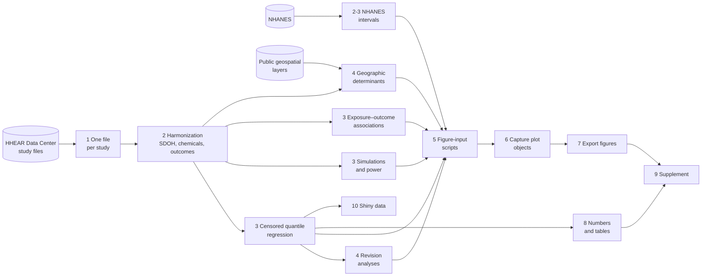

# Population Structure of the Exposome Shapes Epidemiological Inference

Analysis code for *Population Structure of the Exposome Shapes Epidemiological
Inference* (Lloyd D. T., Patel C. J., *et al.*; under review at *Science*).

The paper pools targeted chemical biomarker data from 38 studies in the NIH
Human Health Exposure Analysis Resource (HHEAR). It estimates how much of the
variation in chemical concentrations is explained by where and when each
population was sampled, and shows how that structure affects exposure–outcome
estimates from pooled data.

This branch, `submission3`, holds the code for the revised submission. Earlier
versions are in the git history.

- **Interactive explorer:** <https://chiragjp.shinyapps.io/HHEAR_Exposome_Explore/>
  (source in [`HHEAR_Man1_App/`](HHEAR_Man1_App/))
- **Data:** HHEAR Data Center, <https://hheardatacenter.mssm.edu/> (see
  [Data access](#data-access))

---

## Repository layout

The number after each entry is its step in [Running the pipeline](#running-the-pipeline).

```
Coding/
├── HHEAR_Dataset_Creation.Rmd           1    raw HHEAR files -> one .RData per study
├── HHEAR_Data_Clean_V2.Rmd              2    demographic and social (SDOH) variables
├── HHEAR_Data_Clean_Targeted_V3.Rmd     2    chemical concentrations: units, LODs, urine dilution
├── rebuild_harmonized_targeted.sh       2    runs the V3 harmonization (use this, not the Rmd directly)
├── HHEAR_Data_Clean_Outcomes.Rmd and
│   HHEAR_*Health_Outcomes*.R            2    health outcomes
├── IMHRD_Reconstruct_Distribution.R     2    external PFAS reference series (fig. S11C)
├── build_targeted_analyte_mapping.py    2    chemical -> exposure-class lookup
├── Final_Quantile_Reg_Pipeline/
│   └── NHANES_Replication/              2-3  US reference intervals from NHANES
├── Paper1_Submission2/                  3    models, simulations, power
│   ├── Reviewer_Round2/                 4    analyses added in revision
│   └── Vis_Code/                        5-7  figures
├── Matrix_Stratified/                   3-5  blood vs urine sensitivity analysis (fig. S20)
├── Hero_Numbers.Rmd, Hero_Numbers_Supp.Rmd    8   every number quoted in the text
├── export_supplementary_figs.sh,
│   rebuild_supplement.sh                9    supplementary figures and document
├── Supplementary_Build/                 9    builds the supplementary materials .docx
├── build_hhear_man1_app_bundle.{sh,R}   10   data for the Shiny app
└── install_packages.R                        installs the R packages
HHEAR_Man1_App/app.R                          the Shiny explorer
Input/, Output/                               empty; filled by the pipeline
```

Each folder under `Coding/` has its own README with more detail. The pipeline
also creates `Datasets/` (raw downloads) and `Health_Outcome_Analysis/`
(outcome-analysis inputs and results) at the top level; both are excluded from
git.

## Pipeline



## Running the pipeline

**Requirements**
- R ≥ 4.4. `Rscript Coding/install_packages.R` installs every package the code uses.
- Python ≥ 3.10.
- Node ≥ 18, for the supplementary `.docx` (run `npm install` in `Coding/Supplementary_Build/`).
- poppler (`pdftoppm`, `pdfunite`).
- A SLURM cluster for the power simulations. The between-cohort one needs about
  two days of CPU time; the within-cohort one runs locally in about an hour.

**Working directory.** Render `.Rmd` files from their own folder. Run the `.R`
scripts in `Coding/Paper1_Submission2/` from that folder too (`render_chain.sh`
handles both). Run everything in `Reviewer_Round2/` and `Matrix_Stratified/`,
plus `capture_plots.R`, `capture_all.sh` and `Science_*Figures.R`, from the
repository root. Scripts that need the root take it from `HHEAR_ROOT` when that
is set. Set `LANG=en_US.UTF-8` for every step.

| Step | What | How |
|---|---|---|
| 0 | Get the data | See [Data access](#data-access). |
| 1 | One file per study | `Coding/HHEAR_Dataset_Creation.Rmd` |
| 2 | Harmonize | Demographics: `HHEAR_Data_Clean_V2.Rmd`<br>Chemicals: `bash Coding/rebuild_harmonized_targeted.sh`, then `build_targeted_analyte_mapping.py` and `IMHRD_Reconstruct_Distribution.R`<br>Outcomes: `HHEAR_Data_Clean_Outcomes.Rmd` → `HHEAR_Stack_HealthOutcomes_From_DataDicts.R` → `HHEAR_Clean_Stacked_Health_Outcomes.R` → `HHEAR_Make_Harmonized_Outcomes_Compatible.R` → `sync_health_outcome_targeted_csv.R`<br>NHANES: `download_nhanesa.R`, `download_nhanesa_exposure.R` → `NHANES_Quantile_Reg_Survey_Design.Rmd` → `NHANES_Ref_Intervals_Plot.Rmd` |
| 3 | Models, simulations, power | See [`Paper1_Submission2/README.md`](Coding/Paper1_Submission2/README.md) and [`Matrix_Stratified/README.md`](Coding/Matrix_Stratified/README.md). |
| 4 | Revision analyses | See [`Reviewer_Round2/README.md`](Coding/Paper1_Submission2/Reviewer_Round2/README.md). |
| 5 | Figure inputs | `bash Coding/Paper1_Submission2/Reviewer_Round2/render_chain.sh direct matched pooled fig3 burden corr`, then the other "Built by" scripts in the figure map below. Run `Vis_Code/All_Patchplots.Rmd` last. |
| 6 | Capture plot objects | `bash Coding/Paper1_Submission2/Vis_Code/capture_all.sh` |
| 7 | Export figures | `Rscript Coding/Paper1_Submission2/Vis_Code/Science_Figures.R`<br>`Rscript Coding/Paper1_Submission2/Vis_Code/Science_Supp_Figures.R` |
| 8 | Numbers and tables | `Coding/Hero_Numbers.Rmd`, `Coding/Hero_Numbers_Supp.Rmd`<br>`python3 Coding/Paper1_Submission2/Reviewer_Round2/R4_5_supp_tables.py` |
| 9 | Supplementary document | `bash Coding/rebuild_supplement.sh` |
| 10 | Shiny data | `bash Coding/build_hhear_man1_app_bundle.sh`. Always run this last: several figure scripts also write into the app folder, and the builder must overwrite them. |

## Figure and table map

"Built by" is the script that makes the figure's content; "Upstream" lists the
scripts whose results it uses. The final PDF and SVG files are written by
`Vis_Code/Science_Figures.R` (Figs. 1–3) and `Vis_Code/Science_Supp_Figures.R`
(figs. S1–S22). Paths starting `Vis_Code/` or `Reviewer_Round2/` are under
`Coding/Paper1_Submission2/`.

### Main figures

| Figure | Built by | Upstream |
|---|---|---|
| 1A | Static map image, not produced by code | — |
| 1B | `Vis_Code/Intervals_ByCountry.Rmd` | `Location_QuantileReg_Fixed.R`; `NHANES_Ref_Intervals_Plot.Rmd`; the urine-only run of `Reviewer_Round2/run_location_unadjusted.sh` (lead overlay) |
| 1C | `Vis_Code/Matched_Intervals.Rmd` | `Age_Sex_Match.Rmd` |
| 2A | `Vis_Code/secular_panel.R` | `Vis_Code/Within_Study_SDOH_Compare.Rmd` ← `Within_Cohort_SDOH_QuantileReg.Rmd`, `IMHRD_Reconstruct_Distribution.R` |
| 2B | `Vis_Code/Science_Figures.R` (built in place) | `Vis_Code/Within_Study_SDOH_Compare.Rmd`, `Within_Cohort_SDOH_QuantileReg.Rmd` |
| 2C, 2D | `Vis_Code/Mother_Child_Compare.Rmd` | harmonized data |
| 2E, 2F | `Vis_Code/SDOH_Intervals.Rmd` | `Location_QuantileReg_Fixed.R` |
| 3A–D | `Vis_Code/combined_realdata_figure.R` | `cohort_regime_diagnostic.R`, `budget_allocation_simulation.R`, `Targeted_ExWAS_Replication.Rmd`. The numbers quoted for Fig. 3 come from `Figure3_Results_Numbers.Rmd`. |

### Supplementary figures

| Fig. | Built by | Upstream |
|---|---|---|
| S1 | `Vis_Code/All_Patchplots.Rmd` | `Vis_Code/Figure2DemoPlot.Rmd`, `Vis_Code/Cumulative_Conc_Plot_Map.Rmd` |
| S2 | `Vis_Code/LOD_File_Analysis.Rmd` | LOD summaries from `HHEAR_Data_Clean_Targeted_V3.Rmd` |
| S3 | `Reviewer_Round2/B3_Analyte_Cohort_Overlap.R` | harmonized data |
| S4 | `Vis_Code/All_Patchplots.Rmd` | `Vis_Code/Geography_PCA.Rmd`, `Vis_Code/Location_Compare.Rmd`, `Vis_Code/Age_Sex_Match_Compare.Rmd` |
| S5 | `Vis_Code/TEDDY_All_Figures.Rmd` | `TEDDY_Analysis.Rmd` |
| S6 | `Vis_Code/ZIP_All_Figures.Rmd` | `ZIP_Analysis.Rmd` |
| S7 | `Vis_Code/Geography_PCA.Rmd` | `Location_QuantileReg_Fixed.R` |
| S8 | `Reviewer_Round2/R4_5_supp_figures.R` | `R4_5_within_cohort_sources.R`, `R4_5_source_meta_analysis.R`, `R4_5_water.R` |
| S9, S10 | `Reviewer_Round2/R4_5_supp_figures.R` | `R4_5_map.R`, `R4_5_geospatial_*.R`, `R4_5_PAH_*.R`, `R4_5_water.R`, `R4_5_diet_pesticide_lead.R`, `R4_5_analysis_register.R` |
| S11 | `Vis_Code/All_Patchplots.Rmd` | `Vis_Code/Within_Study_SDOH_Compare.Rmd`, `Vis_Code/Mother_Child_Compare.Rmd`, `Vis_Code/secular_panel.R` |
| S12 | `Reviewer_Round2/C2_S8_assemble.R` | `C2_Chemical_Year_Trends.R`, `C2b_Cross_Country_Year_Trends.R` |
| S13 | `Vis_Code/Between_Study_Power_Output_Visualization.Rmd` | `BetweenStudy_Quantile_Power_Array.R` and its collector (SLURM) |
| S14 | `Vis_Code/Power_Output_Visualization.Rmd` | `Targeted_Quantile_Power_Array.R` and its collector |
| S15 | `Vis_Code/Pooling_Simulation_Visualization.Rmd` | `cohort_pooling_simulation.R`, `budget_allocation_simulation.R`, `cohort_regime_diagnostic.R` |
| S16–S18 | `Vis_Code/Burden_Plots_S2.Rmd` | `Exposure_Burden_Creation_Perc_S2.Rmd` |
| S19 | `Vis_Code/Agg_Score_Patchplot_S2.Rmd` | `Correlations_EffectiveVars_S2.Rmd`, `Vis_Code/Burden_Plots_S2.Rmd`, `Vis_Code/BurdenByStudy_CompareR2_S2.Rmd` ← `ByCohort_BurdenExWAS_S2.Rmd`, `Vis_Code/Within_Study_SDOH_Compare.Rmd` |
| S20 | `Coding/Matrix_Stratified/04_supp_figure_matrix.R` | `Matrix_Stratified/01`–`03` |
| S21 | `Reviewer_Round2/R1_2_S17_assemble.R` | `C5_Reference_Changes_Inference.R`, `R1_2_PFOS_LDL_Figure.R` |
| S22 | `Reviewer_Round2/Fig3_Estimator_Forest.R` | `Fig3_Estimator_Comparison.R` |

Figs. S13 and S14 depend on the two SLURM power arrays in step 3, which
`render_chain.sh` does not run; submit them separately (see
[`Paper1_Submission2/README.md`](Coding/Paper1_Submission2/README.md)).

Some script and object names still carry figure numbers from an earlier draft
(for example, `SuppFig_S8_Year_Trends_Combined` is fig. S12). The `FIGS` list
in `Science_Supp_Figures.R` is the definitive mapping.

### Supplementary tables

| Table | Source |
|---|---|
| S1 | `Coding/Hero_Numbers_Supp.Rmd` |
| S2 | `Coding/Hero_Numbers_Supp.Rmd`; CAS numbers curated with `Supplementary_Build/cas_lookup.py` and `pcb_fix.py`, then checked with `validate_cas.py` |
| S3–S8 | Compiled by hand from the harmonized data and study documentation |
| S9 | `Reviewer_Round2/B3_Analyte_Cohort_Overlap.R` (exposure class × continent) |
| S10–S12, data S1 | `Reviewer_Round2/R4_5_supp_tables.py` ← `R4_5_source_inventory.R`, `R4_5_geospatial_*.R`, `R4_5_PAH_cleanfuel.R`, `R4_5_diet_pesticide_lead.R` |

## Data access

This repository contains code only. `.gitignore` excludes `Input/`, `Output/`,
`Datasets/`, `Health_Outcome_Analysis/`, all data file formats, and knitted
`.html` reports (which print data).

- **HHEAR study data** are available from the HHEAR Data Center
  (<https://hheardatacenter.mssm.edu/>) under its data use agreement and
  cannot be redistributed. The paper's reference list cites each dataset by
  DOI. Put each study's downloaded files in `Datasets/<study number>/` and
  start at step 1.
- **NHANES** data are public; `download_nhanesa.R` and
  `download_nhanesa_exposure.R` fetch them with the `nhanesA` package.
- **Geospatial and country-level data** for figs. S8–S10 and tables S10–S12
  are public. Download them to a folder outside the repository and point
  `HHEAR_GEO_CACHE` at it (default `~/HHEAR_geo_cache`). The sources and the
  expected folder layout are in
  [`Reviewer_Round2/README.md`](Coding/Paper1_Submission2/Reviewer_Round2/README.md).

## Citation

If you use this code, please cite the paper (full citation to follow on
publication) and this repository:

> Lloyd D. T., Patel C. J. *Population Structure of the Exposome Shapes
> Epidemiological Inference*: analysis code (Submission 3) [R software]. 2026.
> <https://github.com/dtlloyd96/HHEAR_Population_Analysis>

## License

MIT; see [`LICENSE`](LICENSE).
